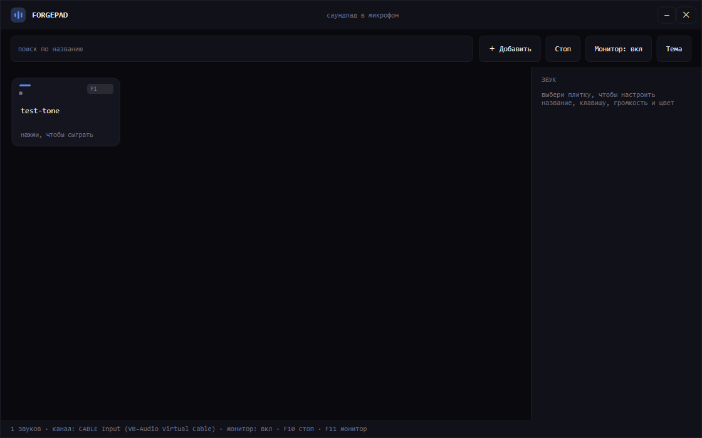
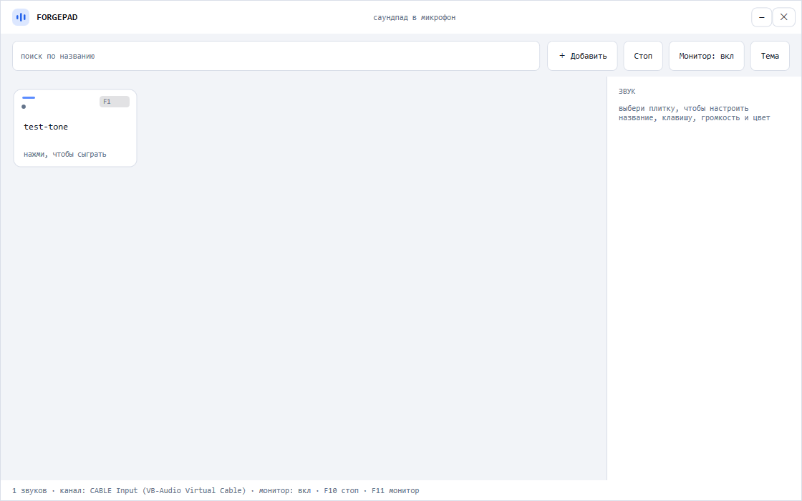

# ForgePad

**Саундпад, который встраивается прямо в твой голос.** Нажимаешь клавишу — звук уходит
в микрофон вместе с речью. Без переключения устройства в Discord, без второго окна,
без «сначала выключи микрофон».



Светлая тема:



---

## Что умеет

- **Звуки в микрофон.** Приложение читает гарнитуру, подмешивает к ней пэды и отдаёт
  один поток в виртуальный кабель. Для Discord, игры или OBS это обычный микрофон.
- **Слышишь себя сам.** Отдельный монитор-выход в наушники: пэды слышно сразу
  (задержка ~60 мс), не дожидаясь собеседника. Переключается на ходу.
- **Свои клавиши.** У каждого звука своя привязка: `F1..F9`, `F12`, цифры, NumPad,
  буквы с `Ctrl/Alt/Shift`. Назначение — нажатием клавиши, конфликты снимаются
  автоматически.
- **Настройка каждого звука.** Название, клавиша, громкость (0–150 %), цвет акцента.
- **Каталог, а не папка.** Файлы копируются в библиотеку, имена живут отдельно,
  одинаковые файлы не дублируются (дедупликация по хешу).
- **9 тем**, переключаются на лету и запоминаются: Ночная, OLED, Светлая, Феникс,
  Маршмеллоу, Красная, Синяя, Фиолетовая, Зелёная.
- **Не оставляет без голоса.** Микрофон по умолчанию перехватывается на время работы
  и возвращается при выходе. Отдельный процесс-сторож вернёт гарнитуру, даже если
  приложение упадёт или его убьют.
- **Поиск, перетаскивание файлов, удаление, переименование** — всё в одном окне.

## Как это работает

```
Гарнитура ──► микшер ──► CABLE Input ──► Discord (CABLE Output)
                  ▲
     твои пэды ───┘

                  └────────► наушники (только пэды, чтобы слышал себя)
```

Физический микрофон нельзя «подмешать» напрямую — это ограничение Windows, для такого
нужен драйвер уровня ядра. Поэтому используется виртуальный кабель
[VB-Audio Cable](https://vb-audio.com/Cable/): приложение пишет в него, а программы
читают его как микрофон. Приложение само делает кабель устройством ввода по умолчанию,
поэтому в Discord достаточно один раз выбрать пункт **«Windows»** (системное по
умолчанию) — дальше переключения не нужны.

## Требования

- Windows 10 или 11 (x64)
- [VB-Audio Virtual Cable](https://vb-audio.com/Cable/) — бесплатно для личного
  использования
- .NET 10 Desktop Runtime — только для маленькой сборки. Вариант `dist` работает
  без установленного .NET

## Установка

### Готовый exe

1. Скачай `ForgePad.exe` из раздела **Releases**.
2. Положи в любую папку и запусти.
3. При первом запуске приложение создаст `Documents\ForgePad`.

Если exe не запускается и пишет про отсутствующий рантайм — поставь
[.NET 10 Desktop Runtime](https://dotnet.microsoft.com/download/dotnet/10.0)
или возьми self-contained сборку.

### Из исходников

```powershell
git clone <адрес репозитория>
cd ForgePad
dotnet build ForgePad.slnx -c Release
dotnet run --project src/ForgePad.App
```

## Быстрый старт

1. **Установи VB-Cable** и перезагрузи компьютер.
2. **Запусти ForgePad.**
3. В Discord: *Настройки → Голос и видео → Устройство ввода* → **Windows
   (VB-Audio Virtual Cable)**. Это пункт «системное по умолчанию».
4. **Добавь звуки**: кнопка «＋ Добавить», `Ctrl+O` или просто перетащи файлы
   в окно (`.wav`, `.mp3`, `.aiff`, `.m4a`).
5. **Нажми плитку** или её клавишу — звук пойдёт в голос, а если включён монитор,
   то и тебе в наушники.

> Совет: первую проверку удобно делать через «Проверку микрофона» в Discord —
> она возвращает твой вход в наушники, и слышно и голос, и пэд.

## Горячие клавиши

| Клавиша | Действие |
| --- | --- |
| `F1`..`F9`, `F12` | играть звук (по умолчанию, можно переназначить) |
| `F10` | остановить всё |
| `F11` | включить/выключить монитор |
| `Ctrl+O` | добавить звуки |
| `F2` | переименовать выбранную плитку |
| `Delete` | удалить выбранный звук |
| `Enter` / `Space` | сыграть выбранный звук |

Привязки работают глобально, даже когда фокус в Discord или игре. `F10` и `F11`
зарезервированы под управление. Для букв и цифр нужен модификатор — иначе перехват
сломал бы печать в других окнах.

## Звуки и данные

Всё лежит в профиле пользователя, рядом с программой ничего не пишется:

```
Documents\ForgePad\
├── sounds\           сами файлы (имя = хеш содержимого, расширение сохраняется)
├── library.json      каталог: названия, клавиши, цвета, громкость
└── settings.json     тема и прочие настройки
```

- Импорт **копирует** файл: оригинал можно удалить, пэд продолжит работать.
- Переименование в интерфейсе **не трогает файл** — имя живёт только в каталоге.
- Чтобы перенести саундпад на другой ПК, скопируй папку `ForgePad` целиком.
- Удаление папки = полный сброс.

## Темы

Кнопка **«Тема»** в панели инструментов. Палитра применяется сразу, без перезапуска,
и сохраняется между запусками.

| Тема | Характер |
| --- | --- |
| Ночная | тёмно-синяя, синий акцент |
| OLED | чистый чёрный, бирюза |
| Светлая | светло-серая, синий |
| Феникс | тёплый уголь, оранжевый |
| Маршмеллоу | светло-розовая |
| Красная / Синяя / Фиолетовая / Зелёная | насыщенные моно-палитры |

## Сборка

```powershell
# маленький один файл (нужен .NET 10 Desktop Runtime), ~1 МБ
dotnet publish src/ForgePad.App -c Release -r win-x64 --self-contained false -p:PublishSingleFile=true -o single

# self-contained папка (~155 МБ, работает без .NET)
dotnet publish src/ForgePad.App -c Release -r win-x64 --self-contained true -o dist
```

## Архитектура

```
src/
├── ForgePad.Core/        аудиоядро, не зависит от интерфейса
│   ├── MixerEngine.cs        дуплексный WASAPI: микрофон + пэды → кабель и монитор
│   ├── AudioHelpers.cs       микшер, приведение каналов, декодирование
│   ├── SoundLibrary.cs       каталог, импорт с дедупликацией, library.json
│   ├── GlobalHotkeys.cs      перехват клавиш через WH_KEYBOARD_LL
│   ├── HotkeyBinding.cs      разбор и проверка привязок
│   ├── MicTakeover.cs        перехват микрофона по умолчанию и возврат
│   └── AudioDevicePolicy.cs  смена устройства через IPolicyConfig
└── ForgePad.App/         WPF-интерфейс
    ├── PadGrid.cs            сетка плиток с ручной отрисовкой
    ├── ThemeManager.cs       палитры и переключение на лету
    └── MainWindow.xaml       окно, инспектор, меню
```

Несколько решений, которые оказались важными:

- **Аудиоядро живёт в отдельном MTA-потоке.** WPF-поток работает в STA, и объекты
  NAudio, созданные в нём, «стартуют», но не пишут ни одного сэмпла.
- **Запас микрофона 80 мс.** WASAPI при `Play()` разом вытягивает свою латентность,
  и без запаса буфер сразу опустошается.
- **Микрофон фиксируется по ID до перехвата.** Иначе после смены устройства по
  умолчанию приложение возьмёт собственный кабель и получит петлю.
- **Сетка рисуется вручную.** Виртуализация получается бесплатно: рисуются только
  видимые ряды.

## Диагностика

В репозитории есть консольный инструмент для проверки звука без интерфейса:

```powershell
# уровни микрофона и кабеля
ForgePad.MixerTest.exe --level --seconds 10

# что реально доходит до кабеля
ForgePad.MixerTest.exe --listen 5

# задержка от нажатия до кабеля
ForgePad.MixerTest.exe --latency-test "путь\к\звуку.wav"

# вернуть микрофон гарнитуры, если что-то пошло не так
ForgePad.MixerTest.exe --restore
```

Лог приложения пишется рядом с exe в `forgepad.log`.

## Известные ограничения

- **Задержка через кабель ~300–400 мс** — это буфер VB-Cable, а не приложения
  (напрямую в наушники звук приходит за ~60 мс). Для голосового чата сойдёт, для
  музыки в реальном времени — нет.
- Пока приложение работает, «микрофон по умолчанию» — кабель. Если убить и
  приложение, и сторожа, гарнитуру вернёт команда `--restore`.
- Форматы на выходе кабеля: 32-бит float или PCM16. Другие дадут понятную ошибку.
- Только Windows.

## Планы

- Портативный режим (данные рядом с exe, для флешки)
- Профили наборов звуков
- Зацикливание и обрезка прямо в приложении
- Сворачивание в трей и автозапуск
- Уменьшение задержки через VoiceMeeter

## Лицензия

MIT — см. [LICENSE](LICENSE).

VB-Audio Virtual Cable — сторонний продукт, в репозиторий не входит.
